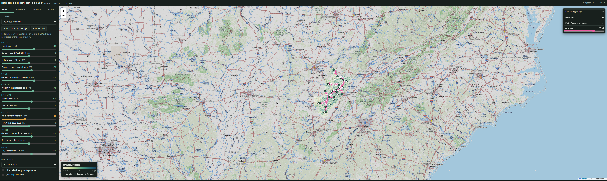

# SEEDS: Southern Environmental & Economic Development Strategy

**ARC ARISE planning project · University of Alabama in Huntsville technical tools**

SEEDS is building the plan for a **Southern Appalachian Greenbelt Corridor** across 12 counties in Northeast Alabama and Southeast Tennessee. It links conservation, outdoor recreation, tourism and workforce development in the region's gateway communities.

| | |
|---|---|
| Prime recipient | Appalachian Conservation Institute (ACI) |
| Subrecipient (this repo) | University of Alabama in Huntsville (UAH) |
| Partners | Land Trust of North Alabama · University of the South, Sewanee · South Cumberland Tourism Partnership (advisory) |
| Period of performance | Oct 2026 – Apr 2028 (18 months) |
| Counties | **AL:** Madison, Marshall, Jackson · **TN:** Franklin, Grundy, Marion, Sequatchie, Bledsoe, Warren, Coffee, DeKalb, Van Buren |

UAH's role is to bring geospatial technology, data-driven decision support and stakeholder-informed methods to the regional plan.

---

## Tasks

| Task | Period | Status | Folder |
|---|---|---|---|
| **1 · Stakeholder Consultation and Survey Design** | Oct – Dec 2026 | In design | [Task 1](Task%201%20Stakeholder%20Consultation%20and%20Survey%20Design/) |
| **2 · Multi-County Feasibility Study and Greenbelt Corridor Planning** | Oct 2026 – Sep 2027 | **Planner v0.2 live** | [Task 2](Task%202%20Multi-County%20Feasibility%20Study%20and%20Greenbelt%20Corridor%20Planning/) |
| **3 · Geo-AI Decision Support Prototype** | Oct 2026 – Mar 2028 | **Combined with Task 2** | [Task 3](Task%203%20Geo-AI%20Decision%20Support%20Prototype/) |
| **4 · Economic Impact Assessment Design** | Oct – Dec 2026 | In design | [Task 4](Task%204%20Economic%20Impact%20Assessment%20Design/) |
| **5 · Economic Impact Assessment Implementation and Projection Tool** | Mar 2027 – Mar 2028 | Planned | [Task 5](Task%205%20Economic%20Impact%20Assessment%20Implementation%20and%20Projection%20Tool/) |

### Task 1 · Stakeholder Consultation and Survey Design
County- and community-level consultation and survey tools that capture community priorities, economic considerations and environmental perspectives. The tools are built to feed the GIS and decision-support work directly: survey results become criterion weights that load straight into the corridor planner. The planner's map feedback tool is also a consultation channel.

### Tasks 2 + 3 · Greenbelt Corridor Planner (feasibility study + Geo-AI decision support)



Task 2 (GIS feasibility study and corridor plan) and Task 3 (the Geo-AI decision-support platform) are delivered as **one tool**:

- **Land prioritization:** 16 criteria (forest, NAIP 0.6 m canopy height, rivers, terrain, development pressure, forest loss, protected-land connectivity, existing trails, parks, tourism access, ARC economic need), summarized on ~3,200 H3 hexagons with Google Earth Engine.
- **Geo-AI:** a random-forest model that scores how closely unprotected land resembles the region's protected land.
- **Existing trail network:** trails, greenways, sidewalks and streets from OpenStreetMap, merged with official layers (USGS National Digital Trails, TN State Parks, and partner layers as supplied: Singing River Trail, LTNA, Sewanee, city greenways).
- **Trail-following corridors:** least-cost greenbelt routes that reuse existing trails first and propose new connectors only where there is a gap.
- **Land ownership:** PAD-US public and protected land, plus county parcel lookups that flag easement and acquisition candidates on gap segments.
- **Scenarios and stakeholder input:** conservation, recreation, equity and stakeholder weight presets, imported survey weights, and map comments stored in a Google Sheet.

**Open the planner:** https://mayert1.github.io/ARC_ARISE_SEEDS/tool/ (once hosting is enabled, see below)
**Method, data and settings:** [FACT_SHEET.md](Task%202%20Multi-County%20Feasibility%20Study%20and%20Greenbelt%20Corridor%20Planning/greenbelt_corridor_planner/FACT_SHEET.md)

### Task 4 · Economic Impact Assessment Design
An economic assessment module for gateway communities: indicators for tourism, workforce development and conservation value, aligned with the Task 1 engagement and structured to feed the Task 5 projection tool.

### Task 5 · Economic Impact Assessment Implementation and Projection Tool
An end-user projection tool that estimates the economic contribution of tourism, workforce and conservation initiatives, using real data inputs and scenario forecasting. It is planned to read corridor scenarios from the Task 2+3 planner, such as km of new trail, gateway towns connected and visitor access.

---

## Repository layout

```
README.md                         this page
greenbelt_corridor_planner.png    screenshot used above
.github/workflows/
  pages.yml                       publishes the website on every push to main
  refresh-tiles.yml               refreshes Earth Engine map overlays daily
Task 1 …/                         survey and consultation instruments
Task 2 …/greenbelt_corridor_planner/   the planner (Python pipeline + website + fact sheet)
Task 3 …/                         pointer to the combined Task 2+3 tool
Task 4 …/                         economic assessment framework
Task 5 …/                         economic projection tool
```

## Run the planner locally

```bat
cd "Task 2 Multi-County Feasibility Study and Greenbelt Corridor Planning\greenbelt_corridor_planner"
pip install -r requirements.txt
python -m seeds_cds run --project <gcp-project> --serve
```

## Hosting

The website is static, with no server or database, so any static host works. The full comparison is in fact sheet section 16.

- **GitHub Pages:** Settings → Pages → Source: **GitHub Actions**. `pages.yml` deploys on every push. Pages requires a public repo or a paid GitHub plan.
- **Cloudflare Pages** (works with a private repo; reviewers can be limited to approved emails with Cloudflare Access): connect the repo, leave the build command empty, set the build output directory to `Task 2 Multi-County Feasibility Study and Greenbelt Corridor Planning/greenbelt_corridor_planner/docs`.
- **Earth Engine overlays** expire. `refresh-tiles.yml` renews them daily with an Earth Engine service account (secret `EE_SERVICE_ACCOUNT_KEY`, variable `EE_PROJECT`).
- **Feedback:** deploy `feedback/apps_script.gs` as a Google Apps Script web app and put its URL in `config/seeds.yaml` → `web.feedback_endpoint`.
